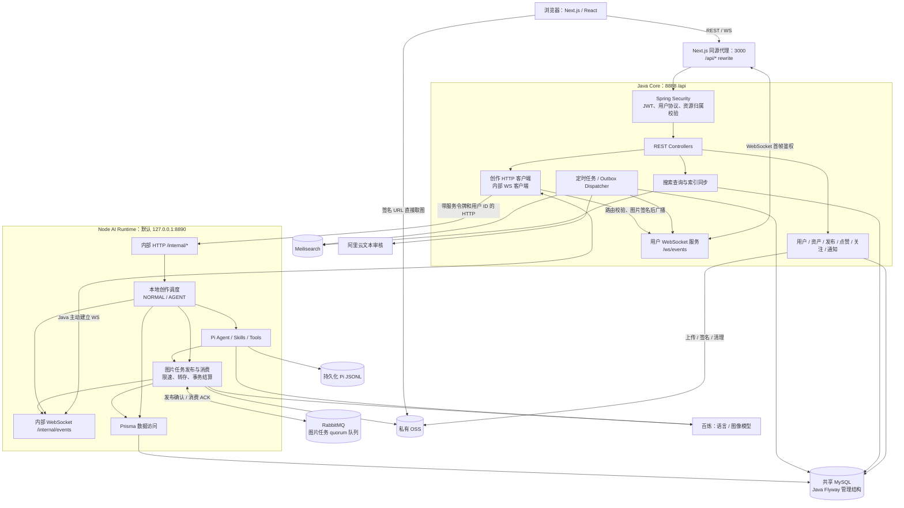
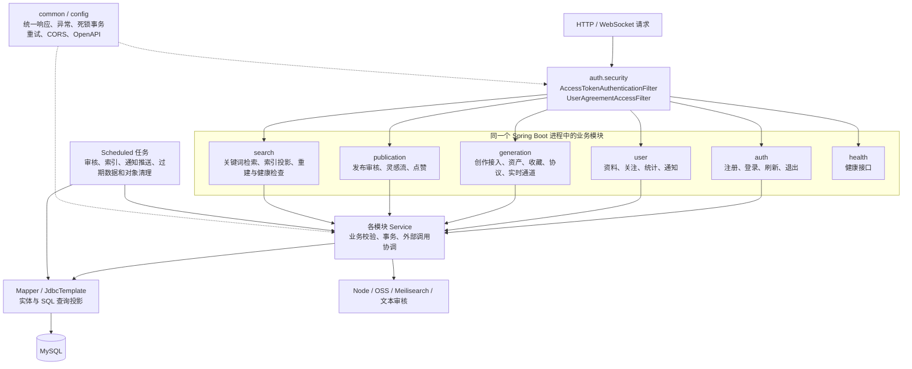
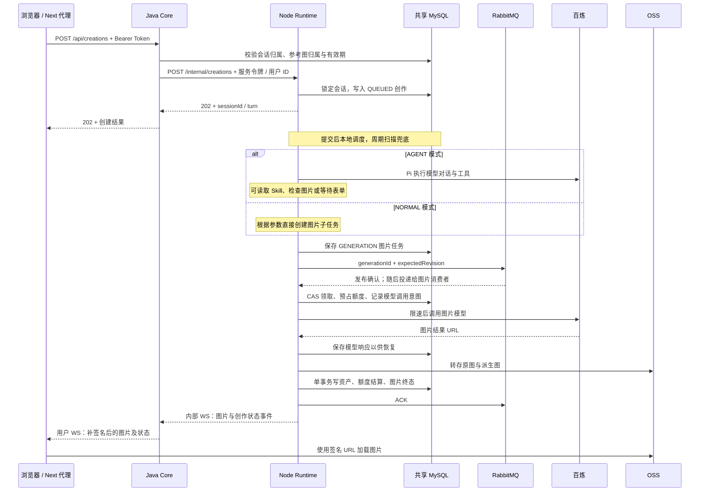
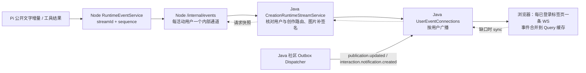
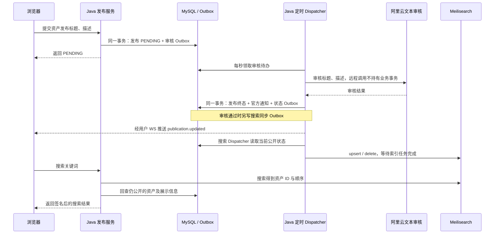

# Java 架构与跨端运行链路

当前项目采用“Java 业务核心 + Node AI Runtime + 共享 MySQL”的结构。Java 是单个 Spring Boot 应用，按业务包划分模块；Node 是独立进程。浏览器的业务请求和实时连接统一进入 Java，创作执行、模型调用、图片队列和生成结算由 Node 承担。

本文依据当前工作区源码梳理，包括尚未提交的 Prisma 数据访问改动。接口字段、重投及实时协议以 [创作通信协议](creation-protocol.md) 为准；Node 内部实现见 [AI Runtime](../worker/AI-Runtime.md)。本文只描述架构和协作，不重复完整接口契约。

## 1. 全系统架构

图中端口为仓库默认配置。Next.js 与 Node AI Runtime 是两个不同进程：前者代理页面的 API，后者执行 AI 创作。

Java 当前没有 RabbitTemplate、RabbitListener 或 Spring AMQP 依赖。`application.yaml` 中保留 RabbitMQ、模型及队列配置，Node 的 `java-local-environment.ts` 可以读取并映射这些配置；配置出现在 Java 文件里不代表 Java 执行了相关任务。

## 2. Java 内部结构

工程路径：`backend/aivista`；入口：`com.superz.aivista.AivistaApplication`。构建声明 Java 25、Spring Boot 4.1.0，使用 Spring MVC、Spring Security、Spring WebSocket、MyBatis-Flex、JdbcTemplate 和 Flyway。

这是按业务包组织的分层单体，并非多个 Java 微服务，也没有独立的领域模型层或 Repository 层。常见结构为 `api → service → mapper/entity`，请求响应通过 `dto` 表达。创作接入还有直接使用 JdbcTemplate 校验共享表的路径。

| 模块 | 实际承担的职责 | 关键入口 / 实现 |
| --- | --- | --- |
| auth | Argon2 密码校验、JWT、Refresh Token 哈希保存与轮换、认证会话清理 | AuthController、AuthService、SecurityConfig、JwtService |
| user | 个人和公开主页、关注关系、用户统计、官方及互动通知 | UserProfileService、UserFollowService、InteractionNotificationWriter |
| generation：创作接入 | 转发会话及创作操作、参考图授权、结构化图片补签名、内部事件订阅 | CreationController、CreationRuntimeClient、CreationRuntimeStreamService、CreationImageService |
| generation：资产 | 参考图上传、资产列表及详情、收藏、下载地址、删除标记、OSS 清理、用户协议 | GenerationAssetController、ImageAssetUploadService、GenerationAssetQueryService、GenerationAssetOssCleanupService |
| generation：事件基础设施 | 浏览器用户连接、心跳、用户广播、Outbox 表访问及清理 | UserEventConnections、OutboxEventMapper、OutboxCleanupService |
| publication | 发布及撤回、标题和描述审核、灵感流、点赞、点赞列表可见性 | PublicationService、PublicationReviewDispatcher、PublicationReviewOutcomeService、InspirationQueryService、GenerationImageLikeService |
| search | 搜索词规范化、限流、Meilisearch 查询、MySQL 回查、增量同步和重建 | InspirationSearchService、SearchIndexOutboxDispatcher、SearchIndexRebuildService |
| common / config / health | ApiResponse、异常映射、事务重试、数据访问扫描、跨域、API 文档及健康入口 | RetryingTransaction、GlobalExceptionHandler、DataAccessConfig、HealthController |

模块之间通过 Spring Bean 直接调用，没有进程内消息总线作为必经层。`generation` 包还承载社区共用的事件和 Outbox 基础设施；`ImageAssetMapper` 查询会联合资产、发布和执行表，因此包边界不是严格的数据隔离边界。

## 3. 数据归属与一致性

| 数据 / 存储 | 主要写入方 | Java 如何使用 |
| --- | --- | --- |
| users、auth_sessions、user_consents | Java | 认证、用户资料、协议门禁；Node 查询用户存在性 |
| user_stats、user_follows、user_notifications | Java | 关注计数、获赞计数、互动和官方通知 |
| generation_sessions | Node | Java 校验归属；列表、历史、改名、删除通过内部 HTTP 交给 Node |
| executions：CREATION / GENERATION | Node | Java 校验资源归属、恢复事件订阅、判断图片任务是否结束；资产查询关联生成参数 |
| image_assets | Node 写生成资产；Java 写上传及资产管理状态 | Java 查询、签名、收藏、删除和清理；Node 生成时写入结果 |
| image_publications、image_asset_likes | Java | 资产与发布状态分表；点赞按发布版本区分 |
| user_generation_daily_usage | Node | 图片任务预占额度与结算 |
| outbox_events | Java | 发布审核、发布状态通知、互动通知和搜索同步待办 |
| Pi JSONL 会话文件 | Node / Pi | Java 经内部 HTTP 获取投影，不直接读取文件 |
| OSS 图片对象 | Java 和 Node | Java 上传参考图、签名和删除；Node 转存生成图片 |
| Meilisearch 文档 | Java | MySQL 公开作品的搜索投影 |

`generation_sessions → executions(CREATION) → executions(GENERATION) → image_assets` 是创作与图片资产主链，图片执行通过 `parent_id` 指向父创作，资产通过 `origin_task_id` 指向图片执行。`image_publications.asset_id` 为资产扩展的发布状态；Java 的 ImageAsset 查询模型会合并这些字段。

两种一致性机制分别处理不同问题：

- **Node 生成事务**：在一个 MySQL 事务内写入交付资产、额度结算和图片任务终态。OSS 上传在 SQL 事务外完成，不能据此认为 OSS 和 MySQL 是原子提交。
- **Java 本地事务 + Outbox**：业务变更与待办一起提交，定时任务稍后执行审核、索引同步及推送。它不是 Java 向 RabbitMQ 发送图片任务的通道。

关注关系与双方计数、点赞关系与作品及作者计数在各自事务中更新。`RetryingTransaction` 对 MySQL 1213 / SQLState 40001 死锁最多尝试三次；外层已存在事务时不在内部局部重放。关注计数按用户 ID 顺序更新，降低相反方向操作的死锁概率。

数据库结构由 Java 的 Flyway V1–V3 管理，Node 当前通过 Prisma 7 访问同一库。结构变更必须同时同步 Prisma schema；升级顺序为停 Node、Java 应用迁移、启动新 Node。

## 4. 前端如何接入 Java

浏览器 Axios 客户端使用 `baseURL=/api`、`withCredentials=true`。Next.js 将 `/api/:path*` 转发至 `BACKEND_ORIGIN`，默认 `http://localhost:8888`。

登录返回短期 Access Token，并写入 HttpOnly Refresh Token Cookie。普通请求带 Bearer Token；令牌需要刷新时走 `/api/auth/refresh`，Java 轮换 Refresh Token。默认 Access Token 15 分钟，Refresh Token 14 天。REST 在 Spring Security 中验证 JWT、协议及接口权限，Controller / Service 继续检查具体资源归属。

| 前端业务 | Java 外部资源，均以 /api 开头 | 处理方式 |
| --- | --- | --- |
| 注册、登录、刷新、退出 | /auth/* | Java 本地处理 |
| 用户和社区身份 | /users/me、/users/{id}、/users/{id}/follow | Java 本地处理 |
| 会话和创作 | /generation-sessions、/creations、表单 response、cancellation | Java 鉴权及授权后调用 Node |
| 资产和参考图 | /generation-images、/uploads、/favorites、/delete、original-download | Java 访问 DB / OSS |
| 发布与灵感 | /generation-images/{id}/publication、/inspirations、/{id}/like | Java 事务和异步审核 |
| 搜索 | /inspirations/search | Java 查询 Meilisearch，回 MySQL 校验公开状态 |
| 通知 | /users/me/official-notifications、interaction-notifications、notifications/unread-count | Java 查询和变更通知 |
| 实时事件 | /ws/events | Java 用户级 WebSocket |

匿名可访问公开灵感、公开用户等部分 GET 接口；个人资源和变更操作要求登录。WebSocket 在 Upgrade 时允许进入，随后五秒内必须发送 authenticate 首帧，Java 校验 Token 和当前用户协议。默认每用户最多三个连接、总计一千个连接。

浏览器通过签名 URL 直接向 OSS 获取图片字节，Java 返回元数据和访问地址。生成图片有原图、card.webp、display.webp；默认展示签名一天，原图下载签名十分钟。

## 5. 一次创作如何完成

图中正常路径不表示 REST 响应、WS 首个事件和后台调度有全局顺序保证；前端允许事件先于创建响应到达。

Java → Node 的 HTTP 固定使用 HTTP/1.1，连接超时五秒，请求超时十五秒。它提交和读取任务，不等待整个模型执行完成。内部请求带 `X-AiVista-Worker-Token` 和 `X-AiVista-User-Id`，Node 校验服务令牌并再次检查资源归属。

Agent Loop 由 Node 本地异步运行，不进 RabbitMQ。需要用户确认时保存 WAITING_INPUT，并结束本次 Loop；浏览器通过 HTTP 提交表单，Node 写入会话并重新调度。取消也走 HTTP，不依赖浏览器 WS 在线。

## 6. MQ 的位置和失败恢复

唯一图片队列为 `aivista.generation.execute.v1`，声明 durable quorum，消息使用持久化投递，只含 `{generationId, expectedRevision}`。提示词、模型参数和授权图片引用保存在 MySQL。

Node 的 GenerationQueueService 既是生产者也是消费者：扫描数据库 QUEUED 图片任务，发送并等待 publisher confirm，随后写 dispatched_at；消费时使用状态和 revision CAS 领取。默认 prefetch=200，模型请求平滑限速为每秒最多启动两次。二百表示未 ACK 名额，不是每秒请求数；等待限速、模型执行、图片转存及结算都会占用名额。

| 故障 / 重复场景 | 当前处理 |
| --- | --- |
| 数据已提交，创作尚未调度 | Node 启动及每秒扫描 QUEUED 创作 |
| MQ 发布确认后，dispatched_at 尚未写入时中断 | 可能重复派发，消费端通过状态、revision 和阶段记录避免重复执行 |
| 重投时模型响应已保存 | 继续图片转存和 SQL 结算 |
| 模型调用意图已记录，但没有可靠响应 | 收口 GENERATION_OUTCOME_UNKNOWN，避免自动再次付费调用 |
| 尚未发给模型就取消 | 阻止请求并按任务状态处理额度释放 |
| 已发给模型后取消父创作 | 图片请求继续保存结果并结算；取消不代表撤销已发生调用 |
| Node 进程重启，创作为 RUNNING | 失败收口；WAITING_INPUT 保留，可继续提交表单 |
| 浏览器 WS 中断 | 后台继续执行，前端重连后用快照及 REST 恢复展示 |

成功处理后 ACK；基础存储等异常导致 execute 拒绝时，消费者延迟 NACK 并重新入队。这里的可靠性来自数据库状态与执行阶段记录，不能把它概括成消息恰好投递一次。

## 7. 实时事件如何跨两端传递

内部连接由 Java 主动建立，而非 Node HTTP 回调。浏览器连接数与内部连接数也不相等：同一用户多个标签页复用 Java 的内部用户通道。正常活动监听在父创作及其图片子任务结束后释放，避免父创作取消后遗漏迟到图片结果。

文字增量直接传递，Java 不累计全文；结构化项、状态和快照分别使用 `creation.item.upserted`、`creation.updated`、`creation.snapshot`。Node 维护内存中的 streamId / sequence，前端用 sequence 和文字 offset 去重；重启换流或发现缺口时读取新快照。历史来自 Pi JSONL、SQL 状态及活跃 Pi SessionManager 的组合投影，不是仅查询一张消息表。

社区事件只触发相关 REST 缓存刷新。Outbox 的“已处理”不表示离线浏览器确认收到，通知正文和未读数仍以 MySQL 为准，前端重连后补查。

## 8. 发布、通知与搜索如何运作

发布审核实际处理标题和描述，使用阿里云 Green 的 TextModerationPlus。Dispatcher 有领取、租约恢复和最多三次审核尝试；失败重试间隔三十秒。审核终态按 publicationVersion 和 PENDING 状态校验，过时结果不会覆盖新发布版本。

关注和点赞在业务事务内生成去重的互动通知及对应 Outbox；Java 的事件 Dispatcher 推给被通知用户。点赞按资产和发布版本维护关系，同时更新作品获赞、作者统计并安排索引同步。

Meilisearch 是最终一致的投影：索引同步按数据库最新公开状态 upsert 或 delete，并非直接重放旧对象快照。查询先取命中 ID，再回 MySQL 排除已经撤回等不可公开记录。搜索服务不可用时返回搜索不可用错误，没有 SQL 模糊检索兜底。

## 9. 部署与维护时要把握的边界

- 当前实时连接、创作调度、Pi 活跃管理器和限流包含进程内状态，设计基线为单 Java、单 Node、一个异步图片消费者；增加副本需要另行处理路由、调度和限速协调。
- 新创作受理依赖 Node 内部 HTTP 在线。MQ 能缓冲图片任务，不能在 Node 停机时替代 Java 接受创作请求。
- 数据备份需同时覆盖 MySQL、Node 会话目录和 OSS；只有数据库不能完整恢复 Pi 原生历史与图片。
- 资产删除与会话删除语义不同：资产删除由 Java 标记并异步清理 OSS；会话由 Node 逻辑删除，保留 JSONL、执行、图片与额度，活动任务未结束时拒绝删除。
- REST CORS 允许来源读取配置；WebSocket 的 UserWebSocketConfiguration 当前单独组装 localhost、127.0.0.1 和本机 IPv4 的 3000 端口来源，生产域名接入需要同步调整这一处。
- Java 使用 @Scheduled 执行审核、索引、推送及清理，内部 Node WS 另有专用定时执行器。若要评估吞吐与心跳延迟，应测量定时任务的实际调度和外部 I/O 耗时。

## 10. 源码阅读入口

| 要理解的链路 | 文件 |
| --- | --- |
| Java 依赖与配置 | [pom.xml](../../backend/aivista/pom.xml)、[application.yaml](../../backend/aivista/src/main/resources/application.yaml) |
| 对外创作入口 | [CreationController](../../backend/aivista/src/main/java/com/superz/aivista/generation/api/CreationController.java) |
| Java → Node 命令与事件 | [CreationRuntimeClient](../../backend/aivista/src/main/java/com/superz/aivista/generation/service/CreationRuntimeClient.java)、[CreationRuntimeStreamService](../../backend/aivista/src/main/java/com/superz/aivista/generation/service/CreationRuntimeStreamService.java) |
| 浏览器鉴权及 WS | [SecurityConfig](../../backend/aivista/src/main/java/com/superz/aivista/auth/security/SecurityConfig.java)、[UserEventConnections](../../backend/aivista/src/main/java/com/superz/aivista/generation/service/UserEventConnections.java) |
| 发布异步处理 | [PublicationService](../../backend/aivista/src/main/java/com/superz/aivista/publication/service/PublicationService.java)、[PublicationReviewDispatcher](../../backend/aivista/src/main/java/com/superz/aivista/publication/service/PublicationReviewDispatcher.java)、[PublicationReviewOutcomeService](../../backend/aivista/src/main/java/com/superz/aivista/publication/service/PublicationReviewOutcomeService.java) |
| 搜索一致性 | [InspirationSearchService](../../backend/aivista/src/main/java/com/superz/aivista/search/service/InspirationSearchService.java)、[SearchIndexOutboxDispatcher](../../backend/aivista/src/main/java/com/superz/aivista/search/service/SearchIndexOutboxDispatcher.java) |
| 数据结构 | [Flyway 基础结构](../../backend/aivista/src/main/resources/db/migration/V1__initialize_schema.sql)、[模型调用阶段迁移](../../backend/aivista/src/main/resources/db/migration/V2__persist_generation_provider_handoff.sql)、[会话逻辑删除迁移](../../backend/aivista/src/main/resources/db/migration/V3__soft_delete_generation_sessions.sql) |
| Node HTTP 与本地调度 | [CreationHttpService](../../backend-ts/src/sessions/creation-http.service.ts)、[CreationDispatcherService](../../backend-ts/src/sessions/creation-dispatcher.service.ts) |
| 图片 MQ 与执行结算 | [GenerationQueueService](../../backend-ts/src/sessions/generation-queue.service.ts)、[GenerationTaskService](../../backend-ts/src/sessions/generation-task.service.ts)、[GenerationSettlement](../../backend-ts/src/sessions/generation-settlement.ts) |
| 配置复用 | [java-local-environment.ts](../../backend-ts/src/config/java-local-environment.ts) |
| 前端接入 | [next.config.ts](../../frontend/aivista/next.config.ts)、[browser-client.ts](../../frontend/aivista/src/shared/api/browser-client.ts)、[实时状态管理](../../frontend/aivista/src/entities/user-event-stream/model/user-event-stream-store.ts) |

## 待确认事项

- 实际部署拓扑和配置覆盖值：缺少部署清单、反向代理配置及运行实例核对，本图端口、心跳和队列参数使用源码默认值。
- 当前环境联通与故障恢复效果：本次为源码架构核对，未启动服务或调用真实模型，缺少当前环境的 HTTP / WS / MQ 实测记录。
- 高负载下的调度和连接表现：缺少定时任务耗时、连接压力和 MQ 积压下的延迟指标，不能据 prefetch 或连接上限推导实际容量。
